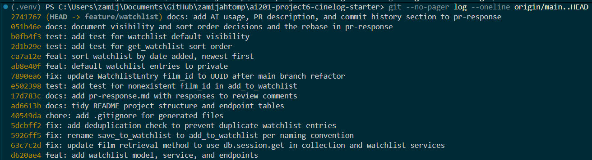

# PR Response Doc — CineLog Watchlist Feature

## AI Usage

I used Claude Code (an AI coding assistant) throughout this project:

- **Codebase orientation.** I asked it to summarize `models.py`: what it is responsible for, its main classes and what depends on it. I used the summary to find the other files that use the models.
- **Understanding a pattern.** I asked what the duplicate check in `add_to_collection()` does and what happens when it finds one. I wrote my own version of the check in `add_to_watchlist()`. I did not have the AI write it.
- **Review of my work.** After I wrote the dedup code, the AI reviewed it. It confirmed the logic worked and pointed out that I had reused `AlreadyInCollectionError` with a message that said "collection", plus some stray indentation. I fixed both myself. I also asked it to check my Comment 3 test against the one it was modelled on. It flagged unused imports and the integer-versus-UUID fake film ID, and I changed the test.
- **Rebase and tests.** The AI ran the rebase onto main and resolved the one-line `models.py` conflict by keeping main's UUID type with my index, and I reviewed the result. It also helped write the two new tests for the sort order and the private default, and checked that each one fails when the code change is reverted.
- **Stress-testing Comments 4 and 5.** I wrote my own first drafts of both responses with my positions: private by default, and sort by date added. I then asked the AI for counterarguments and for tradeoffs I hadn't acknowledged. For Comment 4 it pointed out that nothing in the code enforces `public`, so my draft overstated what the default currently does. It also noted that I never said which mistake is worse, and that most users never change a default. I added those points. For Comment 5 it pointed out that my "Engagement with reviewer's point" field was empty and that alphabetical order is faster for looking up a specific film. I added that counterargument and explained why it doesn't change the default. The AI also helped tighten the wording of the final responses. The positions and the core reasoning (the privacy argument and the "a watchlist is a queue" argument) are mine.
- **Commit history.** The AI split the one commit that bundled the dedup fix with `.gitignore`, README and `pr-response.md` changes, reworded the commit messages, and checked them against the conventional commits format. I checked the final `git log --oneline` myself.

## Comment 1 — Rename

**What I did:** Renamed `save_to_watchlist()` to `add_to_watchlist()` in `services/watchlist_service.py` so it matches the `add_to_collection()` naming convention used in `services/collection_service.py`. Updated the one caller, `routes/watchlist/watchlist.py`, in both the import line and the call site.
**How I verified:** Ran a project-wide search for `save_to_watchlist` before the change, which found three hits: the definition, the import and the call. Re-ran the same search after the change and got zero matches, so no docs, tests or other modules still use the old name. Then ran `pytest tests/ -v` and all 4 existing tests passed.

## Comment 2 — Deduplication

**What I did:** Added a duplicate check to `add_to_watchlist()` in `services/watchlist_service.py`, following the pattern in `add_to_collection()` in `services/collection_service.py`. That function's check queries `CollectionEntry` with `filter_by(user_id=..., film_id=...).first()`, so it looks for an existing row for the same user and the same film. If one is found, it raises `AlreadyInCollectionError` and does not create or return anything. Otherwise it creates the entry. My version runs the same query against `WatchlistEntry`, placed after the film-exists check and before the new entry is created. When a duplicate is found it raises `AlreadyInCollectionError` and writes nothing. I also updated the POST route in `routes/watchlist/watchlist.py` to catch that error and return HTTP 409 with the message, which is how `routes/collection.py` handles it.
**How I verified:** Ran a script against an in-memory database. It added the same film to the same user's watchlist twice. The second call raised the error and `WatchlistEntry` still had exactly one row. `pytest tests/ -v` still passes (4 tests). `WatchlistEntry` has no unique constraint like `CollectionEntry`'s `unique_user_film_collection`, so this service-level check is the only guard against duplicates.

## Comment 3 — Missing test

**What I did:** Created `tests/test_watchlist.py` with `test_add_to_watchlist_nonexistent_film_raises`. I modelled it on `test_add_to_collection_nonexistent_film_raises` in `tests/test_collection.py`, and copied the same `app` and `sample_user` fixtures, the same `app_context()` wrapper, and the same `pytest.raises(FilmNotFoundError)` assertion. The only change is that it calls `add_to_watchlist()` instead of `add_to_collection()`. It uses the integer 999999 rather than the UUID string in the model test. Film.id is an integer on this branch, and a large number can't collide with a real film if a sample_film is added later.
**How I verified:** Ran `pytest tests/test_watchlist.py -v` and the new test passed. Then ran `pytest tests/ -v` and all 5 tests passed (4 collection, 1 watchlist), so the new file did not break anything.

## Comment 4 — Default visibility

**My position:** I'm changing the default from `public=True` to `public=False`, so a watchlist entry is private unless the user chooses to share it. The reviewer pointed out that `public=True` was inherited rather than chosen, and I agree it shouldn't stay that way. Today the `public` flag is stored and returned but nothing enforces it, so the default decides what a user *intends* to share. The first version of the visibility rules should lean toward privacy.

**Reasoning:** A watchlist shows what someone is planning to watch, which can reveal their tastes and interests before they've chosen to share anything. CineLog is a community app, so people will expect their lists to be visible to others in some form, but that should be their decision. Most users never change a default, so whichever value I pick becomes the real behavior for nearly everyone. If the default is wrong, a private default means someone's list stays hidden, while a public default means it was exposed without them ever choosing that. The first mistake is easy to fix and the second can't be undone, because the information has already been seen.

**Tradeoff acknowledged:** The cost is social: since most users won't opt in, most watchlists will stay invisible, so features like seeing friends' watchlists or community recommendations will have less to work with at first. A public default would make those features look better on day one. I accept that. Those features don't exist yet, and opt-in sharing (for example a toggle when adding, or on the profile) can be added later without a data migration. It is much harder to make already-exposed lists private again. I'd also suggest the same private-by-default rule for any future user lists, so the project has one documented decision. This reasoning will also go in the PR description, as the reviewer asked.

**How I verified:** Changed `WatchlistEntry.public` to `default=False` in `models.py` and added `test_add_to_watchlist_defaults_to_private` in `tests/test_watchlist.py`. It adds a film through `add_to_watchlist()` and asserts `entry.public is False`, then reads the row back from the database and asserts the same, so it checks the stored value and not only the in-memory object. To confirm the test actually checks the default, I temporarily set `default=True`: the test failed with `assert True is False`, and it passed again after I restored `default=False`. `pytest tests/ -v` passes (7 tests). I searched the code for other uses of `public` and found only the column, `to_dict()`, and `get_watchlist()`, which returns the value. Nothing filters on it, so the default changes what new entries say but doesn't change who can currently see them. Enforcing visibility would be a separate change.

## Comment 5 — Sort order

**My position:** I'm adopting the reviewer's preference: `get_watchlist()` now defaults to date added, newest first, instead of alphabetical by title. This matches `get_collection()`, so the two lists behave consistently.
**Reasoning:** A watchlist is a queue. People add a film when they hear about it and come back to it soon after, so the most recently added entries are the ones they are most likely to act on or want to confirm. Sorting by `date_added` descending puts those first, and it also avoids a join to `Film` that only existed to sort by title.
**Engagement with reviewer's point:** The reviewer's argument is that "most users want to see what they added recently", and I agree with it for the default view. Their point has a limit, though: someone with a long list who wants to check whether a specific film is already on it can scan an alphabetical list faster than a date-ordered one. That case matters, since it's the check that prevents adding duplicates, but it doesn't change the default, because it's a lookup, while the default should serve the common case of browsing. So the default is date added, and an optional `?sort=title` parameter could serve the lookup case later. I have not added it in this PR, to keep the change small.
**How I verified:** Added test_get_watchlist_returns_newest_first, modelled on the collection sort test, and confirmed it fails against the old alphabetical sort.

## Comment 6 — Rebase

**What conflicted:** I ran `git fetch origin` and `git rebase origin/main`. Main had one new commit, `57ec3f9 refactor: migrate film IDs from integer to UUID`, which touched only `models.py`. The conflict was one line in `models.py`, on `WatchlistEntry.film_id`. Main had changed it to `db.String(36)`, while my branch's first commit (the one that added the watchlist model) still had `db.Integer` plus `index=True`. The conflict appeared while that first commit was being replayed, and the other five commits applied cleanly.
**How I resolved it:** I kept main's UUID type and my index, so the line became `db.Column(db.String(36), db.ForeignKey("film.id"), nullable=False, index=True)`. I then ran `git add models.py` and `git rebase --continue`. Because that fix was folded into the replayed commit, I made a separate commit afterwards, `fix: update WatchlistEntry film_id to UUID after main branch refactor`. It updated the remaining integer references: the `<int>` in the route's request-body comment, the "integer, pre-refactor" note in the `add_to_watchlist()` docstring, and the integer fake film ID in `tests/test_watchlist.py`, which is now a UUID string like the model test.
**How I verified no conflict remains:** Searched all `.py` files for `<<<<<<<` and `>>>>>>>` and found none. Searched the project for `Integer`, `<int>` and `pre-refactor` references to film IDs, and the only integer columns left are `year` and `rating`, which should stay integers. `git log --merges origin/main..HEAD` shows no merge commits, and `git log --graph` shows one straight line on top of `57ec3f9`. `pytest tests/ -v` passes (5 tests). I also exercised the real endpoints with a UUID film ID: the first add returned 201, a repeat add returned 409, an unknown UUID returned 404, and the GET returned 200.

## PR Description

### What the feature does

Adds a watchlist so a user can save films they want to watch later, separate from the collection of films they have already watched.

- `WatchlistEntry` model: a user, a film (UUID), a `date_added` timestamp and a `public` flag.
- `add_to_watchlist(user_id, film_id)` and `get_watchlist(user_id)` in `services/watchlist_service.py`.
- `POST /watchlist/<user_id>/add` returns 201 with the new entry, 404 if the film doesn't exist, 409 if it is already on the watchlist, and 400 if `film_id` is missing.
- `GET /watchlist/<user_id>` returns the user's watchlist, newest first.

### Changes made in response to review

- Renamed `save_to_watchlist()` to `add_to_watchlist()` to match `add_to_collection()`.
- Added a duplicate check, following `add_to_collection()`: the same user and film raises an error and returns 409.
- Added tests for a nonexistent film, the sort order and the default visibility.
- Rebased onto main and updated the watchlist code for UUID film IDs.

### Design decisions

**1. Default visibility: `public=False` (private by default).** A watchlist can reveal someone's tastes before they've chosen to share anything, and most users never change a default, so whichever value I pick becomes the real behavior. A hidden list is easy to fix later by opting in, but an exposed list can't be taken back. The cost is that most watchlists will start out invisible, which gives future friend and community features less to work with. I accept that because those features don't exist yet. Nothing enforces `public` yet: the flag is stored and returned but not checked, so enforcing visibility would be a separate change. I suggest the same private-by-default rule for any future user lists.

**2. Sort order: date added, newest first.** I adopted the reviewer's preference. A watchlist is a queue, and the entries people most want to act on are the ones they added recently. It also matches `get_collection()`. The limit is that someone checking whether a specific film is already on a long list can scan alphabetical order faster, so an optional `?sort=title` could serve that later. I did not add it here, to keep the change small.

### How to test manually

1. Install and seed: `pip install -r requirements.txt`, then `python seed.py`. Note the `user_id` it prints.
2. Start the app: `python app.py` (it runs on `http://localhost:5000`).
3. Get a film ID: `GET http://localhost:5000/films/` and copy the `id` of any film (a UUID).
4. Add it: `POST http://localhost:5000/watchlist/<user_id>/add` with JSON body `{"film_id": "<film id>"}`. Expect **201** and an entry with `"public": false`.
5. Add the same film again. Expect **409** and an "already in" error message, with no second entry created.
6. Add a film that doesn't exist, for example `{"film_id": "00000000-0000-0000-0000-000000000000"}`. Expect **404**.
7. Send a body with no `film_id`. Expect **400**.
8. Add a second, different film, then `GET http://localhost:5000/watchlist/<user_id>`. Expect both films with the **most recently added first**.
9. Run the tests with `pytest tests/ -v`. Expect 7 passing.

## Commit History

